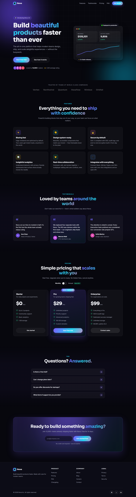

# Nova — Landing Page

A beautiful, modern landing page built with **vanilla HTML, CSS, and JavaScript** — no frameworks, no build step, no dependencies. Just open it in a browser.


---

<p align="center">
  
</p>

---

## ✨ Features

- **Dark theme** with vibrant violet → cyan → pink gradient accents
- **Glassmorphism** navbar and cards with soft glows and a masked grid backdrop
- **Fully responsive** — desktop, tablet, and mobile (hamburger menu included)
- **Scroll-reveal animations** powered by `IntersectionObserver`
- **Animated stat counters** and a self-drawing SVG growth chart
- **Interactive pricing** with a monthly/annual billing toggle
- **FAQ accordion** (single-open, ARIA-ready)
- **Email capture form** with client-side validation and feedback
- **Micro-interactions**: button ripples, cursor-following card glow, hover lifts
- **Accessible**: semantic markup, ARIA attributes, focus states, `prefers-reduced-motion` support
- **Zero dependencies** — no libraries, no build tools, works offline (fonts fall back to system UI)

## 📁 Project structure

```
nova/
├── index.html         # Semantic markup — all sections
├── styles.css         # All styling (no inline styles)
├── script.js          # All interactivity (no inline JS)
├── screenshots/
│   └── preview.png    # Full-page screenshot used above
└── README.md
```

## 🚀 Getting started

No installation or build required.

**Option 1 — Open directly**

```powershell
start .\index.html
```

**Option 2 — Serve locally** (optional, e.g. with VS Code Live Server)

```powershell
npx serve .
```

Then open the URL shown in your browser.

## 🗂️ Page sections

| Section | Description |
|---------|-------------|
| Navbar | Sticky, blurs on scroll, mobile hamburger menu |
| Hero | Gradient headline, CTAs, animated dashboard card |
| Logos | "Trusted by" company strip |
| Features | 6 cards with icons and cursor glow |
| Testimonials | 3 quotes with a featured highlight card |
| Pricing | 3 tiers with monthly/annual toggle |
| FAQ | 4-item accordion |
| CTA | Email signup form with validation |
| Footer | Brand, link columns, socials, dynamic year |

## 🎨 Customization

All design tokens live in the `:root` block at the top of `styles.css`:

```css
:root {
  --bg: #07070d;            /* page background */
  --primary: #7c5cff;       /* primary accent */
  --primary-2: #22d3ee;     /* secondary accent */
  --accent: #f472b6;        /* tertiary accent */
  --gradient: linear-gradient(120deg, #7c5cff 0%, #22d3ee 60%, #f472b6 120%);
  --radius: 18px;           /* card corner radius */
  --font-body: "Inter", ...;
  --font-display: "Sora", ...;
}
```

Change these values to restyle the entire page in seconds. Fonts are loaded from Google Fonts (Inter + Sora) with system fallbacks.

## 🌐 Browser support

Modern evergreen browsers (Chrome, Edge, Firefox, Safari). Uses CSS Grid, custom properties, `backdrop-filter`, and `IntersectionObserver`; older browsers degrade gracefully (content remains visible and usable).

## ♿ Accessibility notes

- Landmarks (`header`, `nav`, `main`, `footer`) and labeled sections
- `aria-expanded`, `aria-checked`, `aria-label` on interactive controls
- Visible focus outlines and keyboard-operable menu/accordion/form
- All decorative graphics marked `aria-hidden="true"`
- Animations disabled automatically when `prefers-reduced-motion` is set

## 📄 License

Free to use for personal or commercial projects. Attribution appreciated but not required.
